# DSO202 — Assignment 3: Assignment 1 with Package and Configuration Management

**Brief:** "Utilize the concepts and knowledge gained from the Unit 4 lectures to effectively implement Assignment 1 using package and configuration management tools."
**Tools:** Kustomize v5.8.1 (built into `kubectl` v1.36) and Helm v4.3.0
**Cluster:** `kind` (`dso202` — 1 control-plane node, 2 worker nodes, Kubernetes v1.36.1), the cluster rebuilt in Assignment 2 (ingress-nginx on the `ingress-ready` control-plane, host ports `8081` and `443`)

Assignment 1 deployed the three-tier Task Tracker with hand-written YAML applied file by file into one namespace. Assignment 3 deploys the same application, with the same images, object names and settings, twice over: once as a **Kustomize base with dev and prod overlays**, and once as a **Helm chart with dev and prod values files**. The application code and images are unchanged; the graded effort is the configuration management.

---

## 1. What Changed from Assignment 1

| Area | Assignment 1 | Assignment 3 |
| --- | --- | --- |
| How it is applied | `kubectl apply -f` per file | `kubectl apply -k overlays/<env>` or `helm install -f environments/<env>.yaml` |
| Environments | One (`dso202-assignment-01`) | `dev` and `prod`, each in its own namespace, from one shared definition |
| Namespace | Hard-coded in every manifest | Not in the shared files; chosen by the overlay or by `helm -n` |
| ConfigMap | `configmap.yaml` | Kustomize `configMapGenerator` (hashed name) / Helm template |
| Secret | `secret.yaml` with the password committed | Kustomize `secretGenerator` from a git-ignored `secret.env` / Helm values from a git-ignored `secrets-local.yaml`. No password is committed |
| Config change → Pods | Manual `kubectl rollout restart` | Automatic: hashed ConfigMap name (Kustomize) or `checksum/config` annotation (Helm) |
| Image tag | Repeated in three Deployments | Declared once (`images:` transformer / `.Chart.AppVersion`) |
| Database update strategy | Default `RollingUpdate` | `Recreate` (see Section 6) |
| Browser access | NodePort 30080, UI showed "Backend unreachable" | Per-environment Ingress host, UI fully working |
| Validation before apply | None | `kubectl kustomize`, `kubectl diff -k`, `helm lint`, `values.schema.json`, `helm test` |

Unchanged from Assignment 1: the three issued images (`sarojsanyasi/dso202-*:1.0`), every object name (`frontend-deployment`, `backend-svc`, `db-svc`, `db-pvc`, `app-config`, `app-secret`, `assignment-quota`, `assignment-limitrange`, `readonly-viewer`, …), the `tier` labels and selectors, the environment variable contract, the ResourceQuota and LimitRange values, and the Task 8 RBAC.

---

## 2. Repository Structure

```
assignment-3/
├── README.md
├── .gitignore                       # secret.env and helm/secrets-*.yaml
├── kustomize/
│   ├── base/                        # Assignment 1, environment-neutral
│   │   ├── kustomization.yaml       # resources, generators, images, labels
│   │   ├── app-config.env           # non-sensitive config -> configMapGenerator
│   │   ├── secret.env.example       # template for the git-ignored secret.env
│   │   ├── quota.yaml  rbac.yaml
│   │   ├── database-{deployment,service,pvc}.yaml
│   │   ├── backend-{deployment,service}.yaml
│   │   └── frontend-{deployment,service}.yaml
│   └── overlays/
│       ├── dev/                     # namespace, ingress, kustomization (merge + inline JSON 6902)
│       └── prod/                    # + replicas, patch-resources.yaml, patch-frontend-svc.yaml
├── helm/
│   ├── tasktracker/                 # the chart
│   │   ├── Chart.yaml  values.yaml  values.schema.json  .helmignore
│   │   └── templates/
│   │       ├── _helpers.tpl         # named templates: labels, selector labels, image, config checksum
│   │       ├── configmap.yaml  secret.yaml  quota.yaml  rbac.yaml
│   │       ├── database.yaml  backend.yaml  frontend.yaml  ingress.yaml
│   │       ├── NOTES.txt
│   │       └── tests/test-connection.yaml
│   ├── environments/{dev,prod}.yaml # per-environment values
│   └── secrets.example.yaml         # template for the git-ignored secrets-local.yaml
└── evidence/                        # screenshots a3-1 … a3-14 (Section 7)
```

---

## 3. Environments

Both tools produce the same two environments:

| Setting | Base / chart default (= Assignment 1) | dev | prod |
| --- | --- | --- | --- |
| Namespace | — | `tasktracker-dev` / `tasktracker-helm-dev` | `tasktracker-prod` / `tasktracker-helm-prod` |
| Frontend replicas | 1 | 1 | 2 |
| Backend replicas | 1 | 1 | 2 |
| Database replicas | 1 | 1 | 1 (single Postgres on one RWO volume) |
| Backend resources | LimitRange defaults | LimitRange defaults | requests `150m`/`192Mi`, limits `400m`/`384Mi` |
| Frontend resources | LimitRange defaults | LimitRange defaults | requests `100m`/`64Mi`, limits `250m`/`128Mi` |
| Frontend NodePort | 30080 | 30180 | 30280 |
| `BACKEND_URL` | `http://backend-svc:8080` | `http://dev.tasktracker.local:8081` | `http://prod.tasktracker.local:8081` |
| Ingress host | — | `dev.tasktracker.local` | `prod.tasktracker.local` |

The NodePort has to differ per environment because two Services cannot hold the same NodePort in one cluster. The hostnames resolve through `/etc/hosts` (`127.0.0.1 dev.tasktracker.local prod.tasktracker.local`) and reach the ingress-nginx controller on host port `8081`.

---

## 4. Kustomize

### 4.1 Base (`kustomize/base`)

The base is Assignment 1 with every `namespace:` line removed, so the same files can be placed in any namespace. Its `kustomization.yaml` uses the three verbs from the lecture:

- **Compose:** `resources:` lists the nine Assignment 1 manifests.
- **Generate:** `configMapGenerator` builds `app-config` from `app-config.env`, and `secretGenerator` builds `app-secret` from `secret.env`. Both get a content-hash suffix (for example `app-config-6kt5b6k58g`), and Kustomize rewrites every `configMapRef`/`secretRef` to the hashed name.
- **Transform:** `images:` declares the issued tag `1.0` once for the three images. `labels:` adds `app.kubernetes.io/part-of` and `managed-by` to metadata and Pod templates with `includeSelectors: false`, so the Assignment 1 selectors (`tier: …`) stay exactly as they were. Selectors on a Deployment are immutable and a Service selector decides routing, so changing them silently would be risky.

### 4.2 Overlays (`kustomize/overlays/dev`, `prod`)

Each overlay starts from `resources: [../../base]` and adds only what differs:

| Feature | dev | prod | Lecture concept |
| --- | --- | --- | --- |
| `namespace:` + `namespace.yaml` | `tasktracker-dev` | `tasktracker-prod` | Cross-cutting transform |
| `labels:` | `environment: dev` | `environment: prod` | Labels without selectors |
| `configMapGenerator` `behavior: merge` | `BACKEND_URL`, `CORS_ORIGIN` | `BACKEND_URL` | Generator behaviour in overlays |
| `replicas:` | — | frontend 2, backend 2 | Purpose-built transformer |
| Strategic-merge patch | — | `patch-resources.yaml` | "Strategic merge speaks Kubernetes" |
| JSON 6902 patch | inline: NodePort 30180 | `patch-frontend-svc.yaml`: NodePort 30280 and annotation `tasktracker.dso202/owner` | "JSON 6902 speaks paths"; `/` escaped as `~1` |
| `ingress.yaml` | `dev.tasktracker.local` | `prod.tasktracker.local` | Environment-specific resource |

The NodePort change uses JSON 6902 because it is one exact path in a list (`/spec/ports/0/nodePort`). The resource change uses strategic merge because it reads as a Kubernetes fragment for the named container. The annotation key contains `/`, so its JSON pointer is `/metadata/annotations/tasktracker.dso202~1owner`.

The rendered output was checked before anything was applied: selectors were still `tier: …`, every Deployment referenced the hashed ConfigMap and Secret, and the `RoleBinding` subject had been moved into the overlay's namespace automatically.

### 4.3 Safe command sequence

Every environment followed the order taught in the lecture:

```bash
kubectl kustomize kustomize/overlays/dev              # 1. render locally
kubectl apply -f kustomize/overlays/dev/namespace.yaml
kubectl diff -k kustomize/overlays/dev                # 2. what would change
kubectl apply -k kustomize/overlays/dev               # 3. apply
kubectl get all,ingress -n tasktracker-dev            # 4. verify
kubectl delete -k kustomize/overlays/dev              # 5. delete when done
```

The namespace is applied on its own before `kubectl diff -k`. The diff is a server-side dry run, and the first attempt failed with `namespaces "tasktracker-dev" not found` because the server cannot place objects in a namespace that does not exist yet.

### 4.4 Results

- **dev:** 3 Pods `Running`, `/api/status` returned `{"status":"ok","db":"connected"}`, `/config.js` served `BACKEND_URL: "http://dev.tasktracker.local:8081"`, and the UI showed "BACKEND + DB ONLINE". A task created in the browser ("Deployed with Kustomize") was stored as id 4. The ResourceQuota counted the Pods (3 pods, `300m` CPU requested): unlike Assignment 1, the LimitRange existed before the Pods, so defaults were injected at admission.
- **prod:** 2 frontend and 2 backend Pods spread over both workers and 1 database Pod. The backend carried the patched resources, the Service the NodePort `30280` and the `platform-team` annotation. The quota showed `600m` CPU and `640Mi` memory requested, which matches the arithmetic (2 × 150m + 2 × 100m + 100m default for the database; 2 × 192Mi + 2 × 64Mi + 128Mi).

### 4.5 Generated-name hash and automatic rollout

In the dev overlay, `CORS_ORIGIN` was changed from `*` to `http://dev.tasktracker.local:8081`, so only the UI's own origin may call the API. `kubectl diff -k` showed the whole chain before anything was applied:

> **content changes → hash changes (`app-config-6kt5b6k58g` → `app-config-tmtg65h7fg`) → reference changes in all three Deployments → Pod templates change → rollout**

After `kubectl apply -k`, each Deployment had a new ReplicaSet and the old one was scaled to 0, without any `kubectl rollout restart`. Task 4 was still present after the database Pod was recreated, because the data lives on `db-pvc`. The backend then answered with `Access-Control-Allow-Origin: http://dev.tasktracker.local:8081`.

The old ConfigMap `app-config-6kt5b6k58g` remained in the namespace: `kubectl apply` creates the new generated object but does not delete the previous one. It was removed with the namespace by `kubectl delete -k`.

---

## 5. Helm

### 5.1 The chart (`helm/tasktracker`)

| File | Purpose |
| --- | --- |
| `Chart.yaml` | `version: 0.1.0` (chart), `appVersion: "1.0"` (the issued image tag) |
| `values.yaml` | Defaults equal to Assignment 1: 1 replica each, NodePort 30080, `BACKEND_URL` = `backend-svc`, quota, LimitRange, RBAC on, Ingress off |
| `values.schema.json` | `environment` must be `dev` or `prod` (no default, so the chart refuses to render without one); replica counts ≥ 1; NodePort within 30000–32767 |
| `_helpers.tpl` | Named templates: common labels, selector labels (`tier` + release), image reference, and the config checksum |
| `secret.yaml` | `required` fails the render when no password is supplied |
| `tests/test-connection.yaml` | `helm test` Pod (busybox) that calls `backend-svc:8080/api/status` and requires `"db":"connected"` |
| `NOTES.txt` | Prints the browser URL and the test command after install |

Two differences from the Kustomize version are deliberate:

- **Selector labels include the release name** (`app.kubernetes.io/instance`), as well as `tier`, so two releases in one namespace could never select each other's Pods.
- **Config changes roll the Pods through a checksum annotation.** Helm keeps the fixed name `app-config`, so the Pod templates carry `checksum/config` and `checksum/secret` (SHA-256 of the rendered templates). A config change alters the hash, which alters the Pod template, which causes a rollout. This is the Helm equivalent of Kustomize's hashed name.

Environment differences live in `environments/dev.yaml` and `environments/prod.yaml`. The password is passed from a git-ignored file, `helm/secrets-local.yaml`.

### 5.2 Validation before installation

| Check | Result |
| --- | --- |
| `helm lint` with dev and with prod values | `1 chart(s) linted, 0 chart(s) failed` (only an informational "icon is recommended") |
| No environment given | Refused by the schema: `at '/environment': value must be one of 'dev', 'prod'` |
| No password given | Refused by `required`: `credentials.password is required` |
| `--set backend.replicaCount=0` | Refused by the schema: `minimum: got 0, want 1` |
| `helm template` | Same objects and names as Assignment 1, plus the Ingress and the test Pod |

### 5.3 Install, test, upgrade, rollback, uninstall

```bash
cd helm
helm install tasktracker tasktracker -n tasktracker-helm-dev --create-namespace \
  -f environments/dev.yaml -f secrets-local.yaml --wait
helm test tasktracker -n tasktracker-helm-dev
helm upgrade tasktracker tasktracker -n tasktracker-helm-dev \
  -f environments/dev.yaml -f secrets-local.yaml --set backend.replicaCount=2 --wait
helm history tasktracker -n tasktracker-helm-dev
helm rollback tasktracker 1 -n tasktracker-helm-dev --wait
helm uninstall tasktracker -n tasktracker-helm-dev
```

| Step | Result |
| --- | --- |
| Install (dev) | Revision 1 `deployed`, 3 Pods `Running`, NOTES printed the URL. UI "BACKEND + DB ONLINE"; task "Installed with Helm" created in the browser |
| `helm test` | `Phase: Succeeded`; the test Pod printed `{"status":"ok","db":"connected"}` |
| Upgrade | Revision 2, backend `2/2`. Every values file was passed again: an upgrade given only `--set` would silently drop the earlier values (the pitfall from the Helm lecture and Practical 6) |
| Rollback to 1 | Created **revision 3, "Rollback to 1"**, rather than returning to revision 1. Backend back to `1/1`; the task created at revision 1 was still there, because a rollback re-applies manifests and does not touch data |
| Uninstall | Every chart object was removed, but the completed `helm test` Pod remained. Test hooks are not deleted on uninstall, so the namespace was deleted afterwards |
| Install (prod) | Same chart, `environments/prod.yaml`: 2 + 2 + 1 Pods, NodePort 30280, `helm test` `Succeeded`, quota `600m`/`640Mi`, identical to the Kustomize prod. Task "Helm prod release" created in the browser |

---

## 6. Kustomize and Helm Compared

| Aspect | Kustomize | Helm |
| --- | --- | --- |
| Model | Plain Kubernetes YAML plus patches; no template language | Go templates rendered with values |
| Where differences live | Overlay directories | Values files |
| Config change → rollout | Built in (hashed generated names) | Has to be written (`checksum/config` annotation) |
| Input validation | None beyond the API server | `values.schema.json`, `required` |
| Release tracking | None: `kubectl apply` has no history | Numbered revisions, `history`, `rollback` |
| Packaging and distribution | A directory in Git | A versioned chart that can be packaged and pushed to a registry |
| Built-in tests | — | `helm test` hooks |
| Cleanup of old generated objects | Not automatic (old hashed ConfigMaps remain) | Release-owned objects are removed on uninstall (except test hooks) |
| Best fit | Small differences between environments of your own manifests | Distributing an application for others to install and configure |

---

## 7. Evidence

Screenshots are in `evidence/`, numbered in the order they were captured.

### Kustomize: render first

The same base renders into two environments: different namespace, hashed ConfigMap name, `BACKEND_URL`, NodePort and replica counts. The `/etc/hosts` entry for the two hostnames was added in the same terminal.

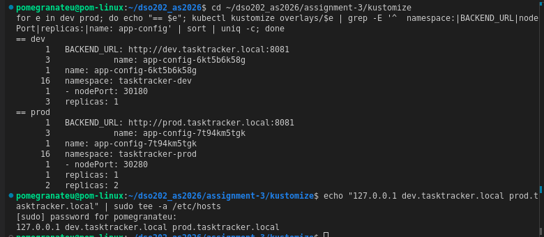

### Kustomize: dev applied

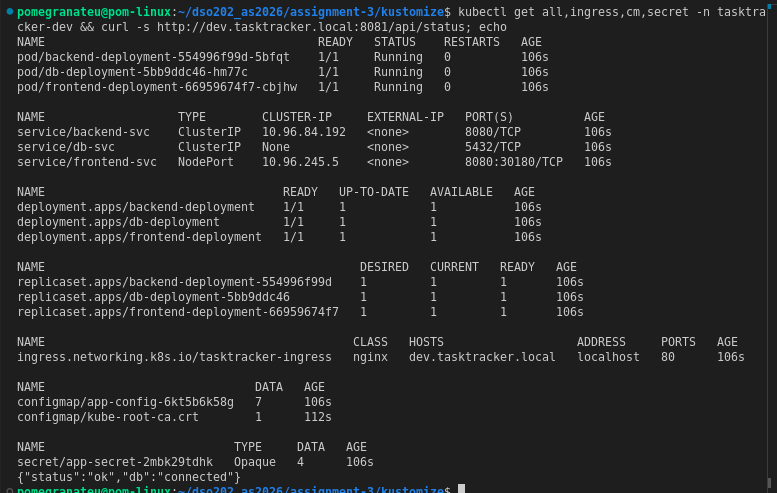

The UI at `dev.tasktracker.local:8081` shows "BACKEND + DB ONLINE". A task was typed and saved from the browser.

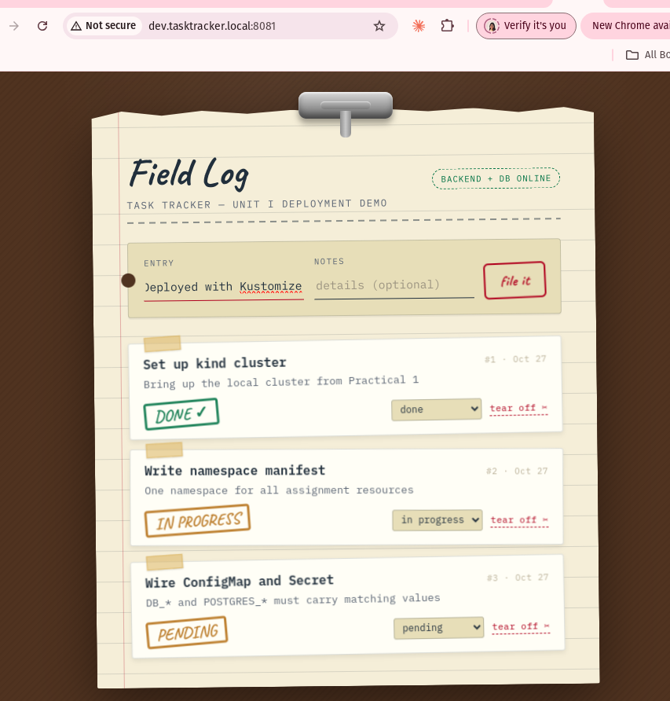
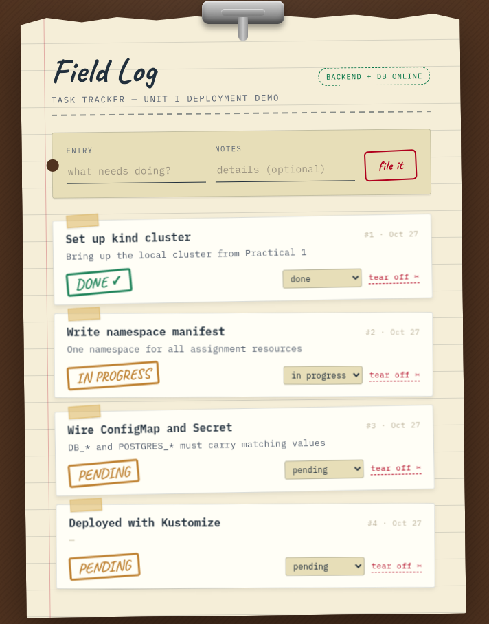

### Kustomize: hash change and automatic rollout

The diff before applying the `CORS_ORIGIN` change: the new ConfigMap name appears in all three Deployments.

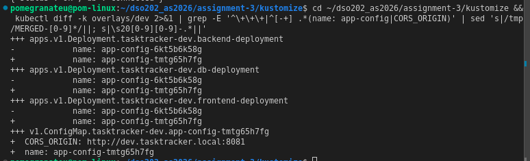

After applying: a new ReplicaSet per tier, the old ones at 0, both ConfigMaps present, and task 4 kept.

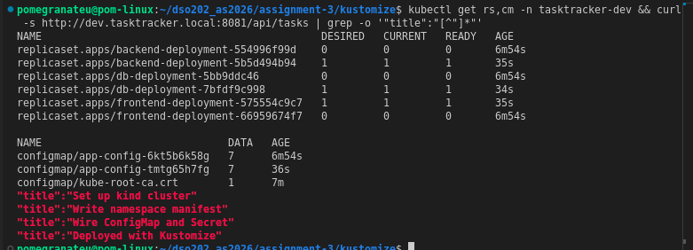

### Kustomize: prod applied

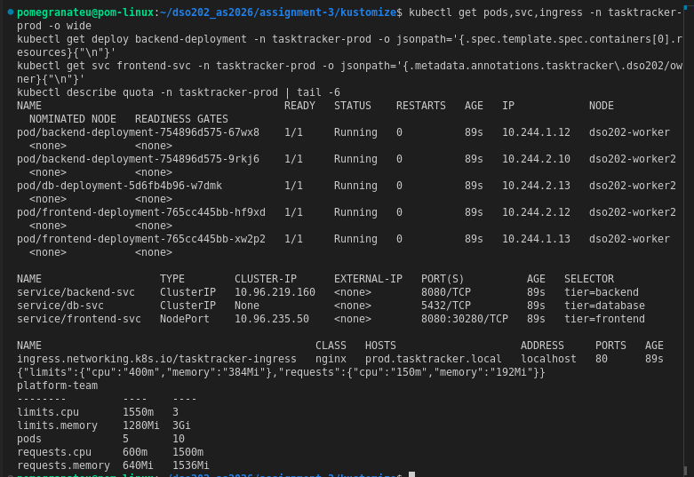
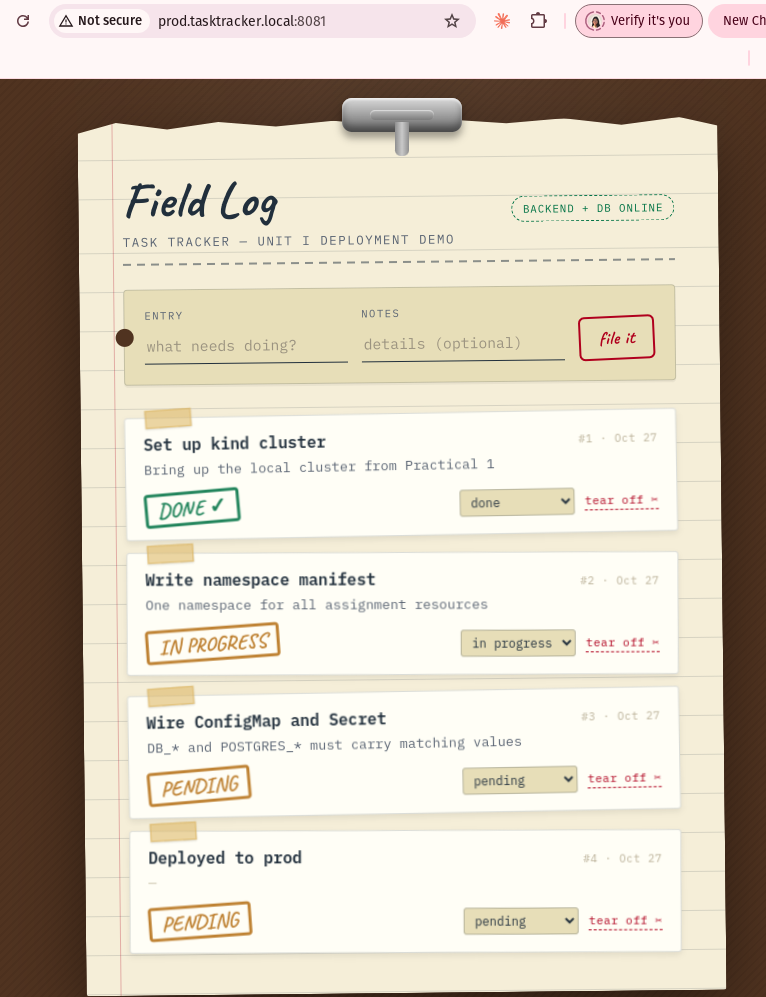

### Helm: validation before install

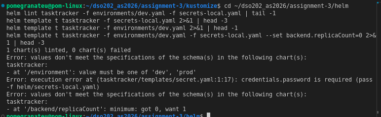

### Helm: dev release installed and tested

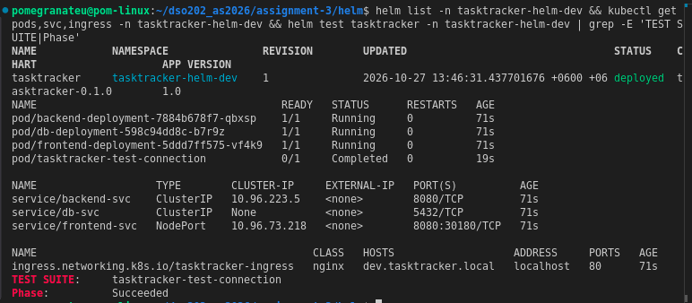
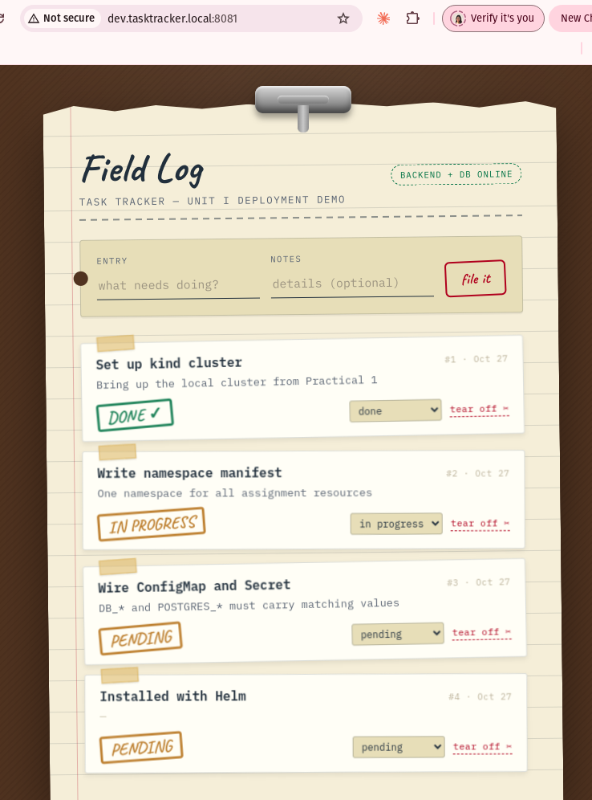

### Helm: upgrade, history and rollback

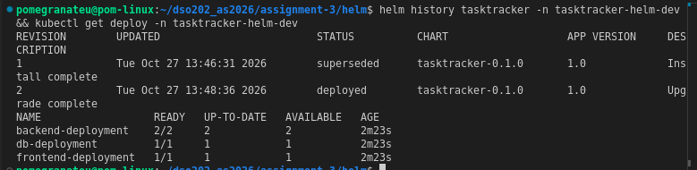
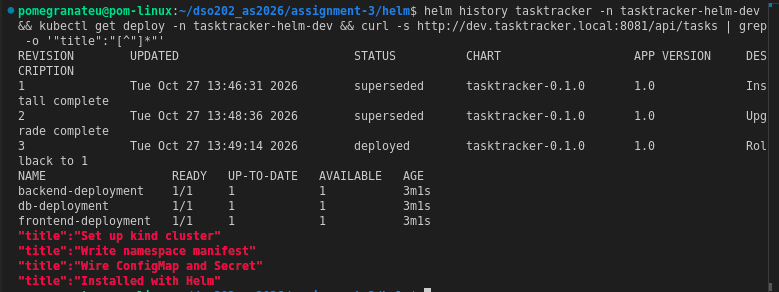

### Helm: prod release from the same chart

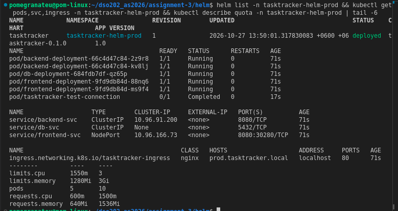
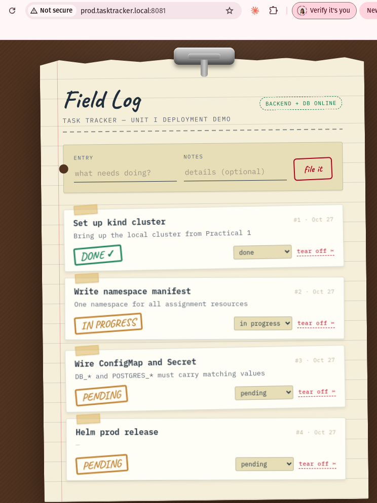

---

## 8. Known Deviations, Constraints and Notes

- **Ingress added.** Assignment 1 exposed only the frontend as NodePort 30080, and the UI showed "Backend unreachable" because a browser cannot resolve `backend-svc`. Each environment here adds an Ingress host on the existing ingress-nginx controller and sets `BACKEND_URL` to it, so the full UI works. The frontend NodePort Service from Assignment 1 is kept, with a different port per environment.
- **Database uses `strategy: Recreate`.** In Assignment 1 the database Deployment had the default `RollingUpdate`. Here a config change rolls every tier, including the database, and a rolling update would briefly run two Postgres Pods against the same ReadWriteOnce volume. `Recreate` stops the old Pod first. The database is unavailable for a few seconds during such a rollout.
- **No password committed.** Assignment 1 committed `secret.yaml` with the password in plain text. Here the Kustomize `secret.env` and the Helm `secrets-local.yaml` are git-ignored, and `.example` templates are committed instead. The generated Secrets are still only base64-encoded in the cluster, not encrypted.
- **Helm stores values in the release record.** Every revision is saved as a Secret of type `helm.sh/release.v1` in the release namespace, including the supplied values. Anyone who can read Secrets in that namespace, or run `helm get values`, can read the database password.
- **Old generated ConfigMaps are not pruned** by `kubectl apply -k` (Section 4.5).
- **`helm test` Pods survive `helm uninstall`** (Section 5.3).
- **Environments were deployed one at a time** and removed after their evidence was captured (the lecture's apply → verify → delete sequence). The tutor's images run under QEMU emulation on this `x86_64` host, and running four copies of the application next to Assignment 2 would exceed the memory available. Each environment's database therefore started from the image's seed data (three tasks); the fourth task in each screenshot was created in that environment's browser session.
- **Hostnames via `/etc/hosts`.** `dev.tasktracker.local` and `prod.tasktracker.local` resolve only on this machine.
- **Unit numbering.** The brief refers to Unit 4; the lecture notes used are titled Kustomize and "Unit III 3.2 — Helm".
- **Assignment 1 and 2 untouched.** Their folders and the Assignment 2 namespace `dso202-assignment-01` were not modified.
