# DSO202 — Practical 4: GitOps with Argo CD on Kind

| | |
|---|---|
| **Name** | Pema Tshering Yangchen |
| **Student ID** | 2230295 |
| **Module** | DSO202 — Scaling, Orchestration, Monitoring & Observability |
| **Practical** | 04 — GitOps and Argo CD |
| **Repository (write-up)** | `dso202_as2026/dso202-practical-04` |
| **Repository (desired state)** | [`pomegranateis/dso202-gitops-demo`](https://github.com/pomegranateis/dso202-gitops-demo) |
| **Date** | 29 October 2026 |

---

## 1. Objectives

By the end of this practical, I aimed to:

- explain the difference between push-based CI/CD and pull-based GitOps;
- install Argo CD in its own namespace and reach its UI on a kind cluster;
- keep the desired state of an application in a GitHub repository;
- register the application with Argo CD declaratively, as an `Application` manifest;
- change the cluster **only through Git** and watch Argo CD apply the change;
- show **self-healing** (a manual `kubectl` change is reverted) and **pruning** (a resource removed from Git is removed from the cluster).

---

## 2. Lab Environment

| Component | Value |
|---|---|
| Host OS | Pop!_OS (amd64) |
| Cluster | kind, cluster `dso202`, context `kind-dso202` (the same cluster as the assignments) |
| Nodes | `dso202-control-plane`, `dso202-worker`, `dso202-worker2` |
| Kubernetes (server) | v1.36.1 |
| Argo CD | v3.5.6 (the release behind the official `stable` install manifest), namespace `argocd` |
| Workload image | `nginxdemos/hello:plain-text` |
| Argo CD UI | `https://localhost:8080` through `kubectl port-forward svc/argocd-server -n argocd 8080:443` |

### Lab topology

```text
 GitHub: pomegranateis/dso202-gitops-demo          kind cluster "dso202"
 ┌──────────────────────────────┐            ┌─────────────────────────────────────────┐
 │ manifests/deployment.yaml    │   pull     │ namespace argocd                        │
 │ manifests/service.yaml       │◀───────────│   repo-server  (clones and renders Git) │
 │ (desired state)              │  (polls    │   application-controller (compares and  │
 └──────────────────────────────┘   Git)     │                           syncs)        │
              ▲                              │   server (UI/API) ◀── port-forward 8080 │
              │ git push                     │                                         │
          developer                          │ namespace demo-app                      │
                                             │   webapp-deploy ─▶ ReplicaSet ─▶ Pods   │
                                             │   webapp-svc                            │
                                             └─────────────────────────────────────────┘
```

Nothing pushes into the cluster. The developer only pushes to Git; Argo CD, running inside the cluster, pulls the change and applies it.

---

## 3. Concepts in Brief

### Push-based CI/CD versus pull-based GitOps

| | Push (the "old way") | Pull (GitOps) |
|---|---|---|
| Who changes the cluster | A CI pipeline (or a person) runs `kubectl apply` from outside | An agent inside the cluster (Argo CD) applies what Git says |
| Credentials | The pipeline needs cluster-admin credentials | The cluster needs only read access to Git |
| Drift | Manual changes stay until the next deploy, unnoticed | Detected continuously and, with self-heal, reverted |
| Audit trail | Pipeline logs | Git history: every change is a commit with an author and a message |

### The four GitOps principles

1. **Declarative:** the whole desired state is described as data (Kubernetes YAML).
2. **Versioned and immutable:** that state is stored in Git, so every version is kept and can be restored.
3. **Pulled automatically:** an agent fetches the desired state; no one pushes to the cluster.
4. **Continuously reconciled:** the agent keeps comparing the live state with Git and corrects differences.

Argo CD is itself a Kubernetes controller. It adds a custom resource, `Application`, and its controller runs the same observe → compare → act loop as the Deployment controller, but compares the cluster with Git instead of with another Kubernetes object.

### Core terms

| Term | Meaning in this lab |
|---|---|
| Application | The `my-webapp` custom resource: which Git path to deploy, to which cluster and namespace, and how to sync |
| Desired state / live state | The YAML in `manifests/` / what is actually running in `demo-app` |
| Sync status | `Synced` when the live state matches Git, `OutOfSync` otherwise |
| Health status | `Healthy`, `Progressing` or `Degraded`, based on the resources themselves |
| Refresh | Re-read Git now instead of waiting for the 3-minute poll |
| Self-heal | Re-sync automatically when the live state drifts from Git |
| Prune | Delete live resources that no longer exist in Git |

---

## 4. Task 1 — Install Argo CD

```bash
kubectl create namespace argocd
kubectl apply -n argocd -f https://raw.githubusercontent.com/argoproj/argo-cd/stable/manifests/install.yaml
kubectl wait --for=condition=Ready pods --all -n argocd --timeout=300s
kubectl get pods -n argocd
```

All seven Argo CD components reached `Running`, spread over the two worker nodes: `argocd-application-controller-0`, `-applicationset-controller`, `-dex-server`, `-notifications-controller`, `-redis`, `-repo-server` and `-server`. The `stable` manifest installed Argo CD **v3.5.6**, which the UI also shows.

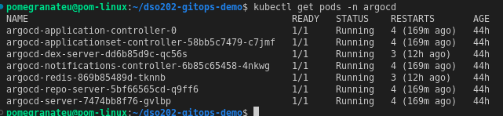

---

## 5. Task 2 — Access the UI

The `argocd-server` Service is `ClusterIP`, so the UI was reached through a port-forward kept running in its own terminal:

```bash
kubectl -n argocd get secret argocd-initial-admin-secret -o jsonpath="{.data.password}" | base64 -d; echo
kubectl port-forward svc/argocd-server -n argocd 8080:443
```

`https://localhost:8080` showed a "Not secure" warning, because Argo CD serves a self-signed certificate by default. After accepting it, I logged in as `admin` with the initial password. The password is not reproduced in this report or in any screenshot.

Port `8080` is normally taken on this machine by a local GitLab (see the Assignment 1 README). GitLab had been stopped beforehand, so the lab's port could be used unchanged.

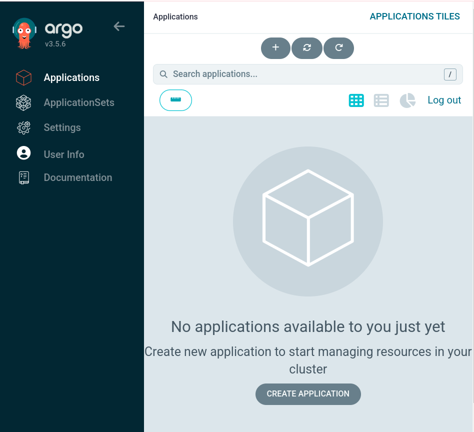

---

## 6. Task 3 — The Desired State in GitHub

Following the lab's golden rule, *keep application code separate from Kubernetes manifests*, the manifests live in their own public repository, [`pomegranateis/dso202-gitops-demo`](https://github.com/pomegranateis/dso202-gitops-demo). This write-up and the screenshots stay in the course repository with the other practicals.

```text
dso202-gitops-demo/
├── README.md
└── manifests/
    ├── deployment.yaml   # webapp-deploy, 2 replicas, nginxdemos/hello:plain-text
    └── service.yaml      # webapp-svc, ClusterIP, port 80
```

The repository has to be public: Argo CD was given no Git credentials, and a private repository would show `ComparisonError`. The initial commit was `6a30395` "Initial deployment with 2 replicas".

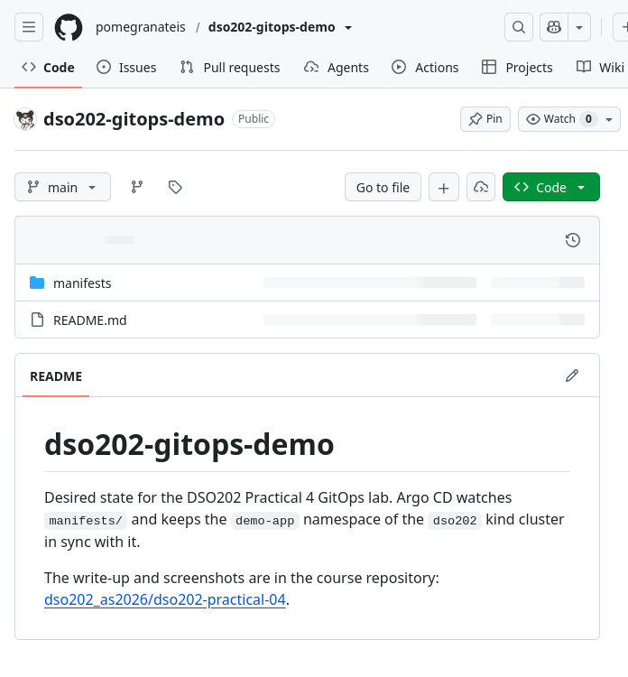

---

## 7. Task 4 — Register the Application Declaratively

Instead of clicking **+ NEW APP**, the application was defined as a Kubernetes resource, [`argocd-app.yaml`](argocd-app.yaml):

```yaml
apiVersion: argoproj.io/v1alpha1
kind: Application
metadata:
  name: my-webapp
  namespace: argocd
spec:
  project: default
  source:
    repoURL: https://github.com/pomegranateis/dso202-gitops-demo.git
    targetRevision: HEAD
    path: manifests
  destination:
    server: https://kubernetes.default.svc
    namespace: demo-app
  syncPolicy:
    automated:
      prune: true
      selfHeal: true
    syncOptions:
      - CreateNamespace=true
```

```bash
kubectl apply -f argocd-app.yaml
```

| Field | Effect |
|---|---|
| `metadata.namespace: argocd` | Argo CD only watches `Application` objects in its own namespace |
| `source` | Read `manifests/` from the newest commit on the default branch (`HEAD`) |
| `destination.server` | `https://kubernetes.default.svc`, the cluster Argo CD itself runs in |
| `automated` | Sync without anyone clicking **Sync** |
| `prune: true` | Delete what was removed from Git |
| `selfHeal: true` | Revert changes made outside Git |
| `CreateNamespace=true` | Create `demo-app`; it did not exist beforehand |

Within seconds the application was **Synced** to `6a30395` and **Healthy**. Argo CD had created the `demo-app` namespace, `webapp-svc`, and `webapp-deploy` with one ReplicaSet and two Pods, one on each worker node.

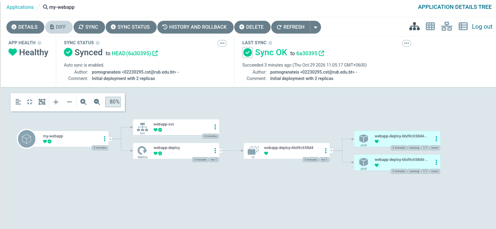
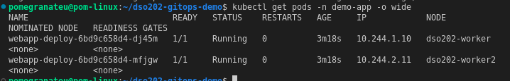

---

## 8. Task 5 — Experiment 1: Git as the Single Source of Truth

`replicas: 2` was changed to `replicas: 4` in `manifests/deployment.yaml` and pushed as commit `50c866a` "Scale webapp to 4 replicas". No `kubectl` command was run against `demo-app`.

After **Refresh** in the UI (otherwise Argo CD polls every three minutes), the application synced to `50c866a` and two new Pods appeared next to the two existing ones: two were "a few seconds" old and two were 5 minutes old. The ReplicaSet stayed the same (`6bd9c658d4`), because only the replica count changed, not the Pod template.

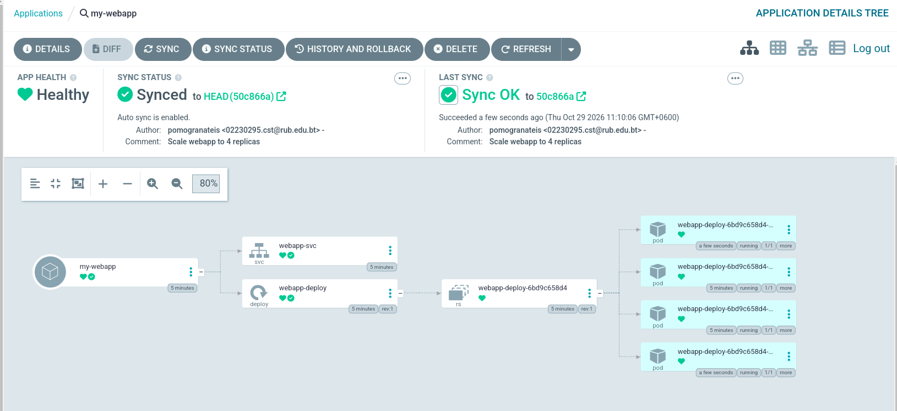
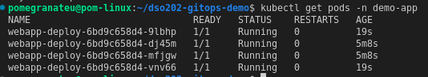

---

## 9. Task 6 — Experiment 2: Configuration Drift and Self-Healing

Acting as a "rogue admin", I scaled the Deployment manually, bypassing Git:

```bash
kubectl scale deployment webapp-deploy -n demo-app --replicas=1
kubectl get deploy webapp-deploy -n demo-app
sleep 10
kubectl get deploy webapp-deploy -n demo-app
kubectl get pods -n demo-app
```

| Moment | `webapp-deploy` |
|---|---|
| Directly after `kubectl scale` | `1/1` |
| 10 seconds later | `4/4`: one original Pod (5m56s) and three new ones (10s) |

Argo CD's events for the application show how fast it reacted. All of these were logged within the same second:

```text
Updated sync status: Synced -> OutOfSync
Initiated automated sync to '50c866ad4aff006f162be524e683b710617829d9'
Partial sync operation to 50c866ad… succeeded
Updated sync status: OutOfSync -> Synced
```

The `OutOfSync` state was too short to catch in the UI, so the event log (Figure 11) is the evidence that it happened. Kubernetes first removed three Pods to honour my manual change; Argo CD then restored the Git value, and the ReplicaSet created three new Pods. With GitOps, a manual change to a managed field does not last; the only lasting way to change the replica count is a commit.

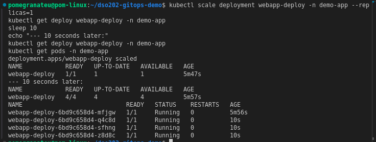
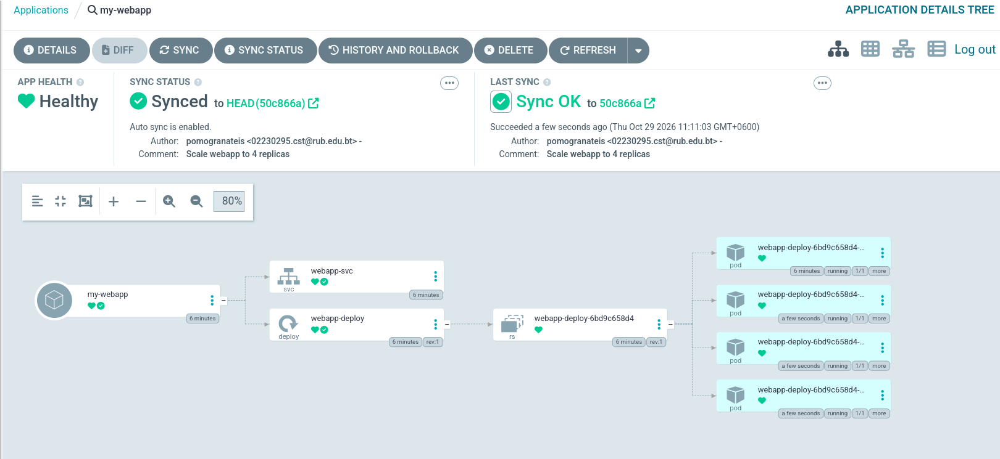

---

## 10. Task 7 — Experiment 3: Automatic Pruning

`manifests/service.yaml` was deleted in Git and pushed as `30c934c` "Remove webapp-svc (pruning test)".

After **Refresh**, the application synced to `30c934c`, `webapp-svc` disappeared from the tree, and `kubectl get svc -n demo-app` returned `No resources found`. Without `prune: true`, Argo CD would only have marked the Service as an orphan, `OutOfSync`, and left it running.

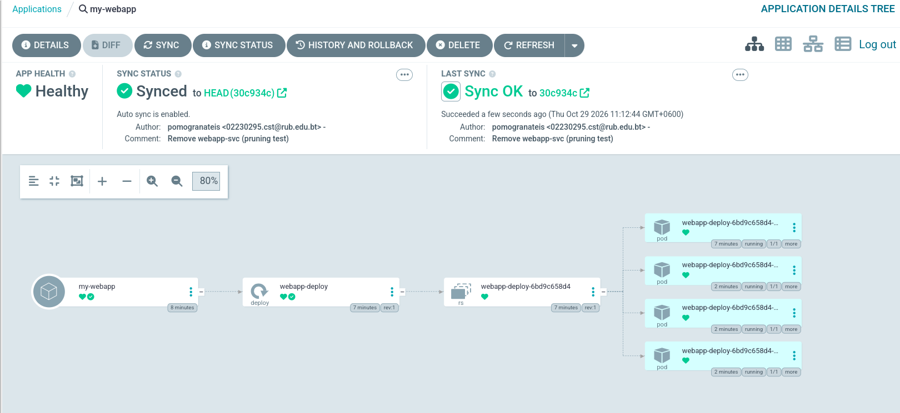
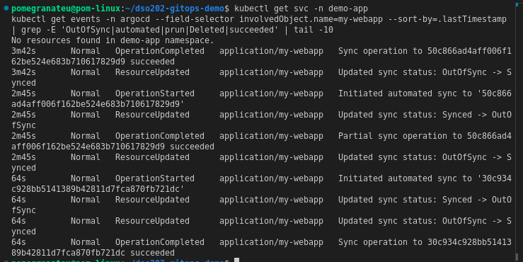

### Restoring the Service with `git revert`

```bash
git revert --no-edit HEAD
git push origin main
```

The revert commit `989e0f6` brought `service.yaml` back. After a refresh, Argo CD recreated `webapp-svc` and the application was again **Synced** and **Healthy**. The undo was itself a commit, so the history still records that the Service was removed and restored.

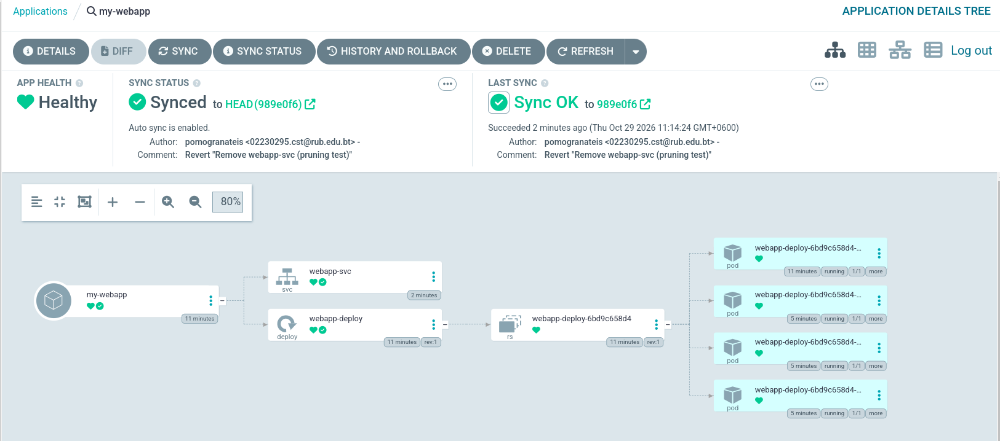

### The Git history is the audit trail

| Commit | Message | What Argo CD did |
|---|---|---|
| `6a30395` | Initial deployment with 2 replicas | Created the namespace, Service, Deployment and 2 Pods |
| `50c866a` | Scale webapp to 4 replicas | Scaled to 4 |
| `30c934c` | Remove webapp-svc (pruning test) | Deleted `webapp-svc` |
| `989e0f6` | Revert "Remove webapp-svc (pruning test)" | Recreated `webapp-svc` |

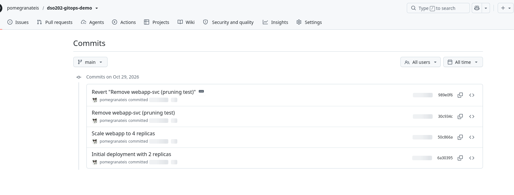

---

## 11. Troubleshooting Reference

| Symptom | Meaning | Fix |
|---|---|---|
| `ComparisonError` | Argo CD cannot read the repo or path | Repo must be public (or credentials added); `repoURL` ends in `.git`; `path` spelled exactly |
| `OutOfSync` that stays | Change seen but not applied | Auto-sync off (click **Sync**), or invalid YAML; read **Sync Status** for the API error |
| `Synced` + `Degraded` | Git matches, but Pods crash | Open the Pod in the UI and read **Events** / **Logs** |
| `Progressing` forever | Rollout not finishing | Not enough CPU/memory on the nodes, or `ImagePullBackOff` |

None of these occurred in this run.

---

## 12. Deviations and Notes

- **Same cluster, not deleted.** The lab ends with `kind delete cluster --name dso202`. That step was not run, because the same cluster hosts Assignment 2 and the Practical 6 Helm releases. Argo CD and `my-webapp` were left installed.
- **Repository name.** The lab names the repository `dso202-gitops-demo` in one step and `k8s-gitops-demo` in the clone command; `dso202-gitops-demo` was used throughout, including in `repoURL`.
- **Refresh from the command line.** For the revert, the refresh was triggered with `kubectl annotate application my-webapp -n argocd argocd.argoproj.io/refresh=normal --overwrite`, the command-line equivalent of the **Refresh** button.
- **Secrets.** The initial admin password stays in the cluster Secret `argocd-initial-admin-secret` and is not written anywhere in either repository. As the lab notes, a real GitOps setup would keep application Secrets out of Git entirely (Sealed Secrets or the External Secrets Operator).
- **Author e-mail in the UI.** Argo CD shows the commit author's name and e-mail (Figures 4, 6, 9, 10, 12). This is the same information GitHub already shows publicly for every commit.

---

## 13. Reflection

- **The commit is the deployment.** In Experiment 1 the only action was a `git push`; the cluster followed. Who changed what, and why, is recorded in the commit message rather than in someone's shell history.
- **Drift does not survive.** Experiment 2 changed a live object directly, and Argo CD put it back within a second. With `selfHeal` on, `kubectl` stops being a way to change managed resources and becomes a way to inspect them.
- **Pruning makes deletion declarative.** Removing a file from Git removed the Service. Without `prune`, deleted resources would quietly accumulate in the cluster, the same problem as the old hashed ConfigMaps in Practical 5.
- **Rollback is just another commit.** `git revert` restored the Service by adding history rather than rewriting it, so the audit trail stays complete.

---

## 14. Conclusion

I installed Argo CD v3.5.6 in its own namespace on the existing three-node kind cluster, put the desired state of a two-replica NGINX demo application in a public GitHub repository, and registered it declaratively as an `Application` with automated sync, `prune` and `selfHeal`. Argo CD created the namespace and resources itself (`6a30395`), scaled the application to four replicas from a Git commit alone (`50c866a`), reverted a manual `kubectl scale` to one replica within a second, deleted the Service when its manifest was removed from Git (`30c934c`), and recreated it from a `git revert` (`989e0f6`). Every change to the application went through Git, and Git's history is the complete record of it.
