# DSO202 Practical 6: Helm (Unit III, 3.2)

**Student:** Pema Tshering Yangchen (2230295)
**Cluster:** kind, `dso202` (1 control plane, 2 workers, Kubernetes v1.36.1)
**Tooling:** Helm 4.3.0, kubectl, Docker

This practical covers the full Helm workflow. It starts by consuming a published chart (`podinfo`), then writes, validates, installs, upgrades, rolls back and promotes a chart of my own (`webapp`) as two releases: `webapp-dev` in `dso202-dev` and `webapp-prod` in `dso202-prod`. The page content, replica count, Service type and resources come from values, not from the templates.

---

## 1. Summary

| Stage | What was done | Result |
|---|---|---|
| 0 | Checked Helm, the cluster and leftover state | Clean start (one stale failed release removed) |
| 1 | Installed `podinfo` from a repo and from OCI; values loss, `--reuse-values`, rollback, uninstall | All behaviours reproduced |
| 2 | Chart skeleton | `Chart.yaml`, `values.yaml` |
| 3 | Templates and helpers | Render matched the reference checksum |
| 4 | Values precedence and layering | `--set` beats `-f`; maps merge, they do not swap |
| 5 | Deliberate failures | `required`, the schema and the server dry run each caught a different class of error |
| 6 | Real install into `dso202-dev` | Deployed and tested with `helm test` |
| 7 | Upgrades and lost values | Silent loss reproduced and repaired |
| 8 | History and rollback | Rollback created a new revision |
| 9 | Drift and server-side apply | Helm 4 refused to overwrite a manual change |
| 10 | Second environment | `webapp-prod` in `dso202-prod`, three replicas |

## 2. Repository layout

```
dso202-practical-06/
├── webapp/
│   ├── Chart.yaml
│   ├── values.yaml
│   ├── values.schema.json          # added in Stage 5
│   ├── .helmignore
│   ├── charts/                     # empty: no dependencies
│   └── templates/
│       ├── _helpers.tpl
│       ├── configmap.yaml
│       ├── deployment.yaml
│       ├── service.yaml
│       ├── NOTES.txt
│       └── tests/test-connection.yaml
└── environments/
    ├── dev.yaml
    └── prod.yaml
```

| File | Purpose |
|---|---|
| `Chart.yaml` | apiVersion v2, name `webapp`, version `0.1.0`, appVersion `1.30-alpine`, `kubeVersion >=1.30.0-0` |
| `values.yaml` | Safe defaults. `page.environment` is deliberately empty so a release cannot be created without choosing one |
| `values.schema.json` | Type and range checks on `replicaCount`, `page.environment`, `service.type`, `service.port`, `service.nodePort` |
| `_helpers.tpl` | Named templates: name, fullname, chart label, selector labels, environment, full label set |
| `configmap.yaml` | The HTML page served by nginx |
| `deployment.yaml` | nginx Deployment with probes, resources and a checksum annotation that restarts Pods when the page changes |
| `service.yaml` | Service with `nodePort` rendered only when the type is NodePort and a port is given |
| `tests/test-connection.yaml` | `helm test` hook Pod that fetches the page and checks the environment name |
| `environments/*.yaml` | Per-environment overrides, kept outside the chart |

## 3. Environment notes

- **Local port 8080** is held by a GitLab instance, so every port-forward uses **8090** (dev) or **8091** (prod). The `NOTES` text of some charts still suggests 8080; I ignored it.
- **NodePort 30080** is held by the ingress-nginx controller Service from Assignment 2. Two Services cannot share a NodePort, so the dev environment uses **30081**.
- The kind cluster maps only host port 30080, so NodePort 30081 works inside the cluster but **not from the host**. The dev page was checked through `kubectl port-forward`.
- Docker Hub and ghcr.io stall intermittently. `nginx:1.30-alpine` and `busybox:1.37` were pulled on the host and loaded with `kind load docker-image` before the first install.

---

## 4. Stage 0: Environment check

Helm v4.3.0 was installed and the cluster was healthy. A stale release `my-podinfo` (status `failed`, description `context canceled`) was left in `dso202-helm` from an earlier attempt. `context canceled` means the original `helm install --wait` was interrupted: the objects were healthy, but Helm recorded the client giving up. I removed it with `helm uninstall` so that Stage 1 could reuse the name. The check for the old `baltocdn` APT source found nothing.

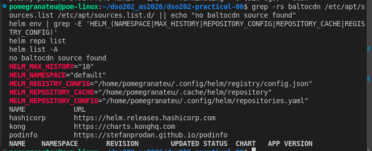

---

## 5. Stage 1: Using a published chart

### 5.1 Inspect and install

After `helm repo update`, `helm search repo podinfo` and `helm show chart podinfo/podinfo --version 6.15.0` showed chart 6.15.0 / app 6.15.0 in the legacy `apiVersion: v1` format, which Helm 4 still installs.

```bash
helm install my-podinfo podinfo/podinfo --version 6.15.0 \
  --namespace dso202-helm --create-namespace \
  --set replicaCount=2 --set ui.message="Hello from DSO202" \
  --wait --timeout 3m
```

The release was `deployed` at revision 1 with two Pods `2/2`. `helm list -n dso202-helm` shows it, while plain `helm list` shows nothing: a release belongs to its namespace.

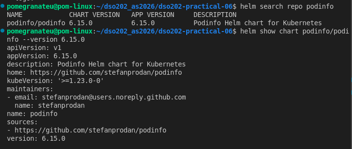
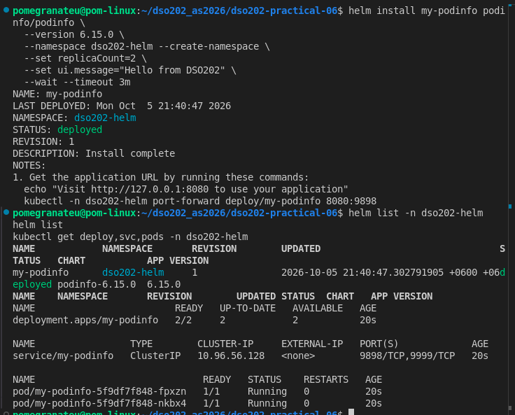

### 5.2 The running app and the release record

The live app (through a port-forward on 8090) reported version `6.15.0` and the message from my `--set`. `helm get values` shows only my two overrides, and `--all` adds the chart defaults. `helm get manifest` lists the Service and the Deployment with the template that produced each.

Helm stores each revision as a Secret, `sh.helm.release.v1.my-podinfo.v1`, labelled `owner=helm`, `status=deployed`, `version=1`. Decoding it (`base64 -d | base64 -d | gunzip | jq`) shows `"apply_method": "ssa"` (Helm 4 uses server-side apply) and my values in clear text. Anyone who can read Secrets in the namespace can read every value passed with `--set`, so passwords should not be passed that way.

> **Figure 4.** `curl` result and `helm get values` in both forms.
> 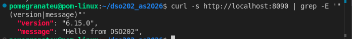
> 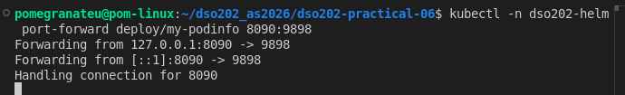
> 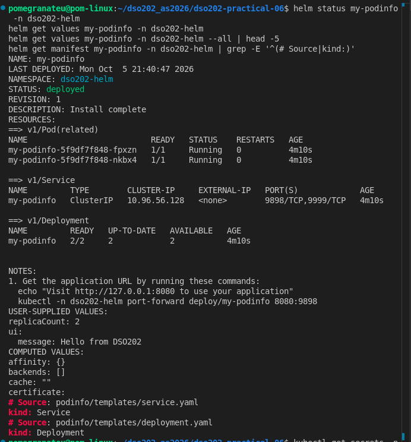

> **Figure 5.** `kubectl get secrets --show-labels`.
> 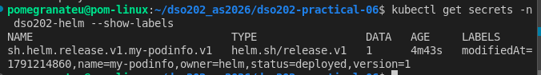
>
> **Figure 6.** The decoded release record.
> 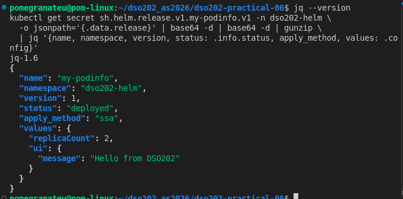

### 5.3 Values loss, `--reuse-values` and rollback

| Revision | Command | Outcome |
|---|---|---|
| 2 | `helm upgrade ... --set ui.color="#2e7d32"` | Reported `Upgrade complete`, but `USER-SUPPLIED VALUES` held only the colour and the Deployment dropped from 2 replicas to 1 |
| 3 | `helm upgrade ... --reuse-values --set replicaCount=2 --set ui.message=...` | Merged with the previous values: `replicaCount: 2`, the colour and the message; 2 replicas |
| 4 | `helm rollback my-podinfo 1` | New revision `Rollback to 1`; values returned to revision 1's, so the colour was gone |

Giving any value flag makes `helm upgrade` start again from the chart defaults, and nothing warned me. The industry fix is to keep every value in version-controlled files and pass them all with `-f` on every upgrade, which Stage 4 builds. A rollback does not return to revision 1; it creates revision 4 as a copy of it. Revisions 1 to 3 stayed `superseded`, and `--revision 2` still showed the broken upgrade.

> **Figure 7.** Values-loss upgrade: revision 2, only `ui.color`, one replica.
> 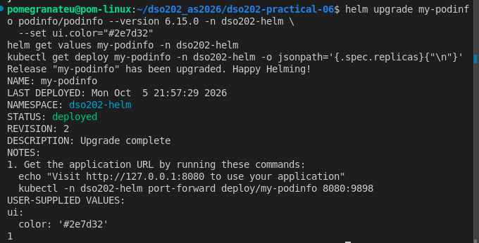
>
> **Figure 8.** `--reuse-values` upgrade: revision 3 and two replicas.
> 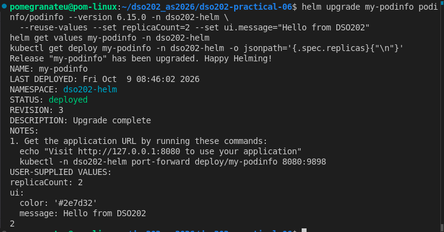
>
> **Figure 9.** Rollback, `helm history` 1 to 4 and the `--revision` outputs.
> 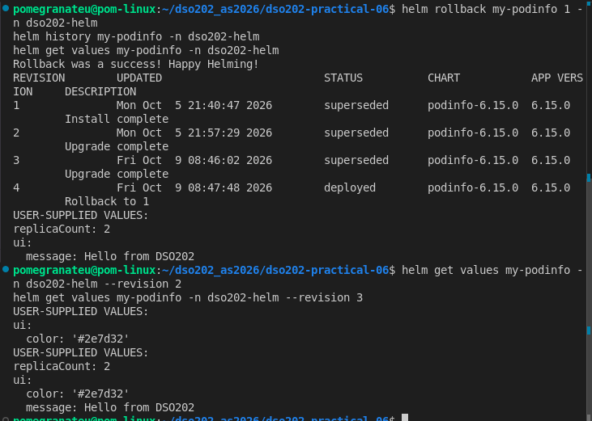

### 5.4 Uninstall and OCI

`helm uninstall` removed every object and all release Secrets in one command. The namespace stayed `Active` because it was never part of the release.

The same chart then installed from `oci://ghcr.io/stefanprodan/charts/podinfo --version 6.15.0` with no `helm repo add`. A registry can hold both images and charts, which is why OCI is replacing HTTP chart repositories.

> **Figure 10.** Uninstall, `No resources found` and the surviving namespace.
> 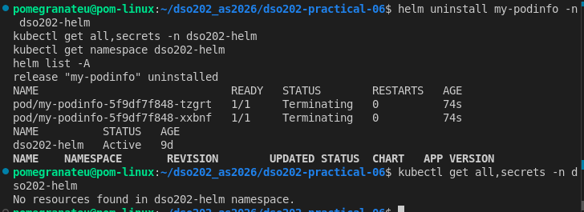
>
> **Figure 11.** OCI install with the `oci://` reference visible.
> 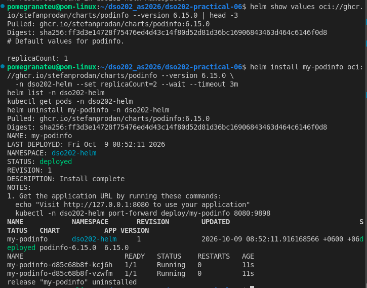

---

## 6. Stage 2: Chart skeleton

`helm create` was run only to see Helm's generated layout, then deleted: the practical builds a smaller chart so each line is explained.

- `Chart.yaml`: `apiVersion: v2`, `type: application`, chart `version: 0.1.0`, `appVersion: "1.30-alpine"` (quoted so YAML keeps it a string) and `kubeVersion: ">=1.30.0-0"`, so the chart refuses older clusters.
- `values.yaml`: `replicaCount`, `image` (an empty `tag` falls back to `appVersion`, so upgrading nginx means editing one field), `page.*`, `service.*` (`nodePort: null`), `resources`, `podAnnotations` and `global.environment`.
- `page.environment` has **no default on purpose**. The chart refuses to render until an environment is chosen.

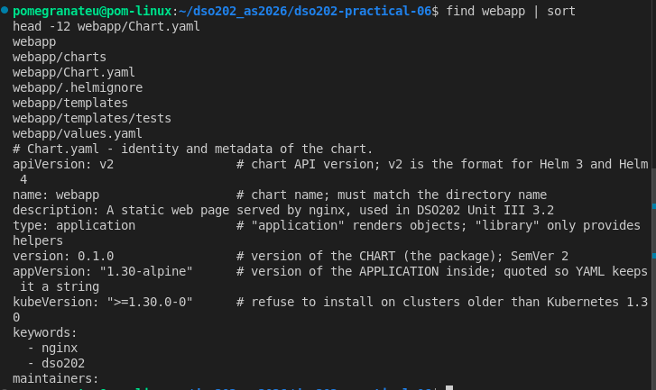

## 7. Stage 3: Templates

- **`_helpers.tpl`** defines `webapp.name`, `webapp.fullname`, `webapp.chart`, `webapp.selectorLabels`, `webapp.environment` and `webapp.labels`. Names are truncated to 63 characters (the Kubernetes DNS and label limit). Selector labels are kept minimal because `Deployment.spec.selector` cannot change after the first install.
- **`webapp.environment`** uses `required`: `page.environment` wins, `global.environment` (set by a parent chart) is the fallback, and if both are empty rendering stops with `page.environment must be set (dev, staging or prod)`.
- **`deployment.yaml`** carries a `checksum/config` annotation, the SHA-256 of the rendered ConfigMap. When the page content changes, the Pod template changes and the Deployment rolls out new Pods; without it a ConfigMap change never restarts anything. It also has readiness and liveness probes and takes resources from `toYaml .Values.resources | nindent 12`.
- **`service.yaml`** emits `nodePort` only when the type is NodePort *and* a port is given.
- **`tests/test-connection.yaml`** is a `helm.sh/hook: test` Pod that fetches the page with busybox and greps for `Environment: <name>`. A block scalar is used because the script contains `: `.
- **`environments/dev.yaml`**: 1 replica, environment `dev`, NodePort 30081. **`environments/prod.yaml`**: 3 replicas, environment `prod`, requests 100m/64Mi and limits 500m/128Mi.

```bash
helm template webapp-dev ./webapp -f environments/dev.yaml --namespace dso202-dev
helm template webapp-dev ./webapp -f environments/dev.yaml -s templates/configmap.yaml
```

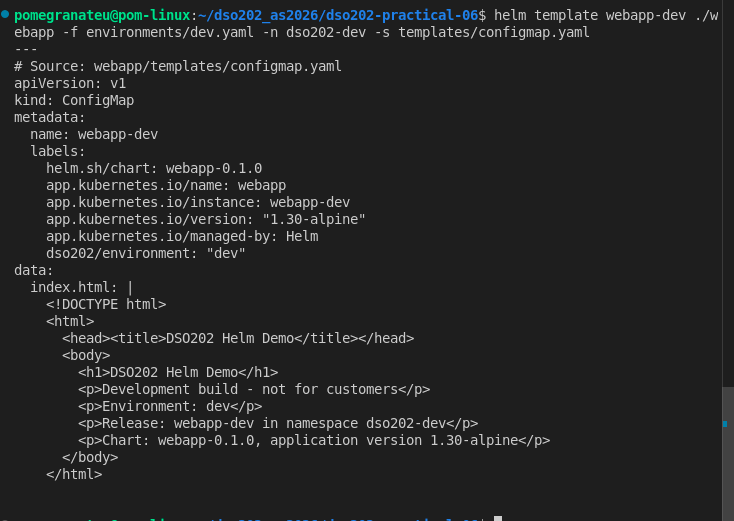

Four objects were rendered (ConfigMap, Service, Deployment, test Pod), all named `webapp-dev`, with the image resolved to `nginx:1.30-alpine` from `appVersion` and NodePort `30081`. The `checksum/config` value was `534e2ce7205f6f1d2d13203ea2dbd1ec7235d260e43331302152c76034b4f88b`, and the same value appeared later in the installed release manifest.

> **Figure 12.** Full dev render and the single ConfigMap render.
> 

---

## 8. Stage 4: Values precedence

Order of precedence, lowest to highest: chart `values.yaml`, then each `-f` file from left to right, then `--set`.

| Command | Result |
|---|---|
| `-f dev.yaml --set replicaCount=2` | `replicas: 2`. `--set` beats the file |
| `-f dev.yaml -f prod.yaml` | Environment `prod`, replicas 3, **but the Service is still NodePort 30081** |
| `-f prod.yaml -f dev.yaml` | Environment `dev`, replicas 1, **but cpu 500m / 100m from prod survive** |
| `--set 'podAnnotations.prometheus\.io/scrape=true'` | Rendered as an unquoted boolean `true` |
| `--set-string` with the same key | Rendered as the string `"true"` |
| `--set resources.limits=null` | The `limits` block is removed; only `requests` remains |

**What this shows.**
- Maps merge key by key. Layering two environment files does not switch environments, it produces a mix of both, and the dev-then-prod combination yields a production release exposed on a NodePort.
- A render can succeed and still be wrong. The unquoted `true` annotation renders without complaint, but Kubernetes requires annotation values to be strings, so the API server would reject it. `--set-string` is the fix.
- `null` is the way to delete a chart default.

> **Figure 13.** The layered renders, dev then prod and prod then dev.
> **Figure 14.** `--set` versus `--set-string` for the annotation.
> 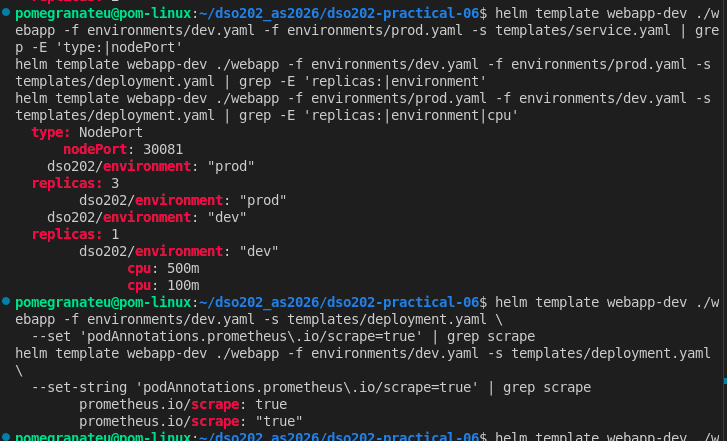
>

---

## 9. Stage 5: Breaking the chart on purpose

| # | Failure | Caught by |
|---|---|---|
| 1 | `page.environment` missing | `helm template` (hard error) |
| 2 | `replicaCount=lots` | nothing, until a schema exists |
| 3 | The same, with `values.schema.json` | `helm template` and `helm lint` |
| 4 | `nodePort=30080` already allocated | `kubectl apply --dry-run=server` only |

### 9.1 The `required` guard

`helm template webapp-x ./webapp` failed with `page.environment must be set (dev, staging or prod)` and produced no YAML. The error names `test-connection.yaml` only because that was the first template rendered when the guard fired; every template calls the same helper.

`helm lint` behaved differently from what I first expected. In Helm 4, a `required` failure during lint is reported as a **warning** (`level=WARN msg="missing required values"`), so `helm lint ./webapp` ended with `0 chart(s) failed`. A passing lint therefore does not prove that a chart can be installed; `helm template` or a server dry run is the real gate.

> **Figure 15.** The `required` error from `helm template`, and both lint runs.
> 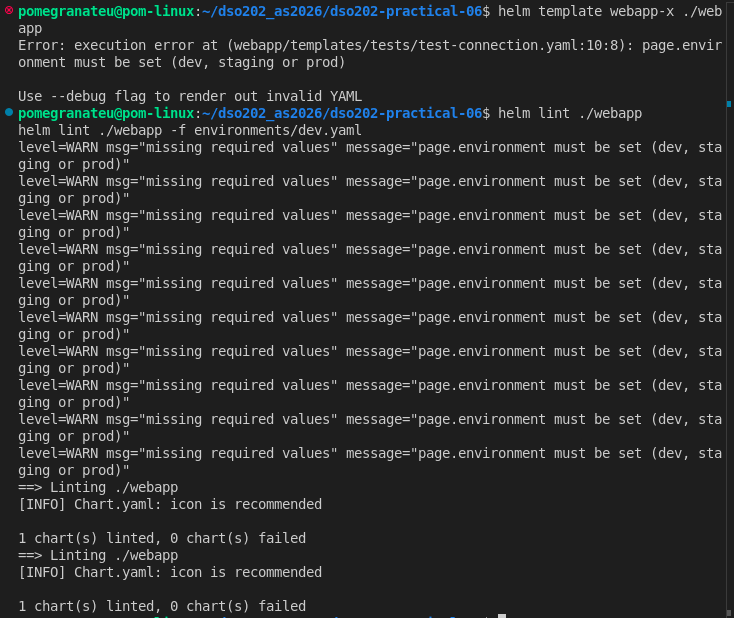

### 9.2 Schema validation

Without a schema, `--set replicaCount=lots` rendered `replicas: lots`. After adding `values.schema.json` (integer `replicaCount` of at least 1, `environment` one of `""`, dev, staging, prod, `service.type` one of ClusterIP and NodePort, `nodePort` between 30000 and 32767), bad values were rejected at render time with the exact path:

| Value | Error |
|---|---|
| `replicaCount=lots` | `at '/replicaCount': got string, want integer` |
| `service.nodePort=80` | `at '/service/nodePort': minimum: got 80, want 30,000` |
| `page.environment=qa` | `at '/page/environment': value must be one of '', 'dev', 'staging', 'prod'` |

Valid values still rendered. Unlike the `required` case, `helm lint ... --set replicaCount=lots` **fails** (`1 chart(s) failed`), because schema violations are errors.

> **Figure 16.** `replicas: lots` before the schema, then the three rejections and a valid render.
> 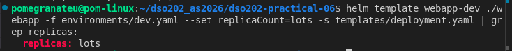
>
> **Figure 17.** `helm lint` failing on the schema violation.
> 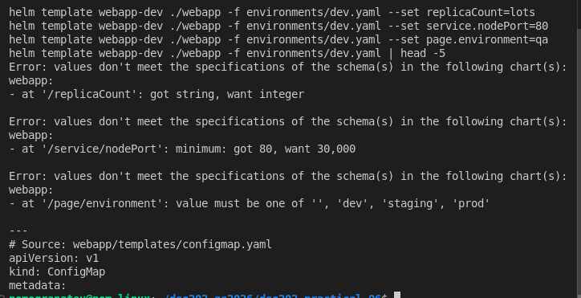

### 9.3 Server dry run versus client dry run

```bash
helm template webapp-dev ./webapp -f environments/dev.yaml --set service.nodePort=30080 | kubectl apply --dry-run=server -f -
helm template webapp-dev ./webapp -f environments/dev.yaml --set service.nodePort=30080 | kubectl apply --dry-run=client -f -
```

Port 30080 is inside the schema's range, so the render passes. The **server** dry run accepted the ConfigMap, Deployment and Pod but rejected the Service: `spec.ports[0].nodePort: Invalid value: 30080: provided port is already allocated`. The **client** dry run accepted all four objects. Only the API server knows which NodePorts are taken, and it also shows which object is at fault.

> **Figure 18.** Server dry run failing next to the client dry run passing.
> 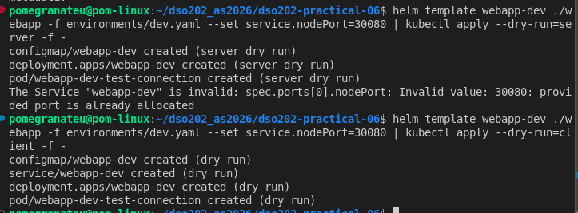

### 9.4 Clean validation

Both environment files pass `helm lint`, and the prod render passes the server dry run (all four objects created). That dry run went to the current namespace: the templates set no `metadata.namespace`, so `--namespace` on `helm template` has no effect on the objects. The namespace only takes effect at `helm install -n`.

> **Figure 19.** Clean lint for both environments and the prod server dry run.
> 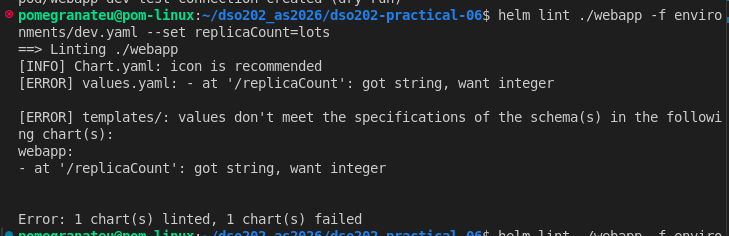
> 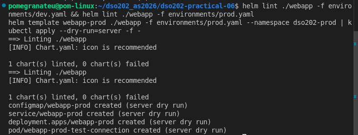

---

## 10. Stage 6: Installing the dev release

```bash
docker pull nginx:1.30-alpine && docker pull busybox:1.37
kind load docker-image nginx:1.30-alpine busybox:1.37 --name dso202

helm install webapp-dev ./webapp -f environments/dev.yaml \
  --namespace dso202-dev --create-namespace --wait --timeout 120s
```

Result: `STATUS: deployed`, `REVISION: 1`, one Pod `1/1 Running`, Service `80:30081/TCP`, Deployment `1/1`. The ConfigMap `kube-root-ca.crt` is added by Kubernetes to every namespace.

A plain `curl localhost:30081` returned nothing because kind maps only 30080 to the host, so the page was fetched through a port-forward:

```bash
kubectl -n dso202-dev port-forward svc/webapp-dev 8090:80
curl -s http://localhost:8090
```

The page showed `Development build - not for customers`, `Environment: dev`, `Release: webapp-dev in namespace dso202-dev` and `Chart: webapp-0.1.0, application version 1.30-alpine`.

`helm test webapp-dev -n dso202-dev` returned `Phase: Succeeded`. The test Pod is a hook, so it does not appear in `helm get manifest`, which lists only the ConfigMap, Service and Deployment.

The release record is one Secret, `sh.helm.release.v1.webapp-dev.v1`. `helm get values` shows only the user-supplied values (`dev.yaml`), and `--all` adds the chart defaults.

> **Figure 20.** Install output with NOTES.
> 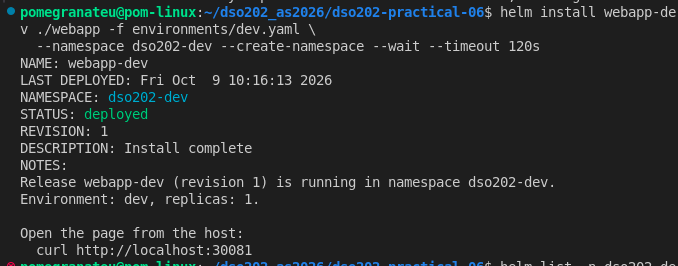
>
> **Figure 21.** `helm list` and `kubectl get all,cm` in `dso202-dev`.
> 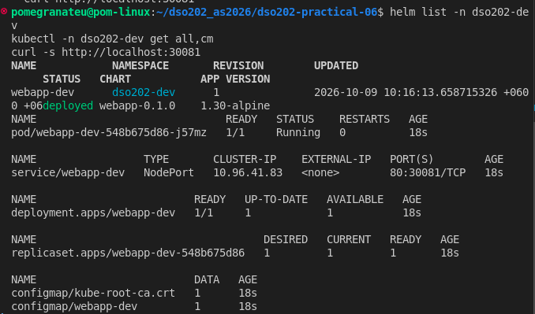
>
> **Figure 22.** The page served through the port-forward.
> 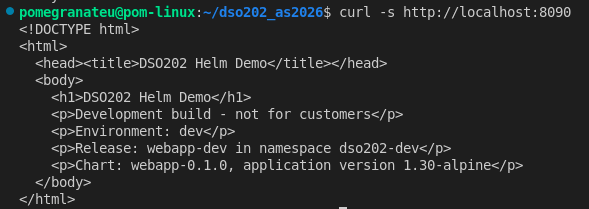
>
> **Figure 23.** `helm test` result.
> 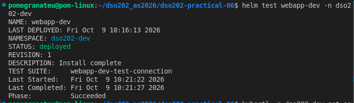
>
> **Figure 24.** Release Secret, user-supplied values and computed values.
> 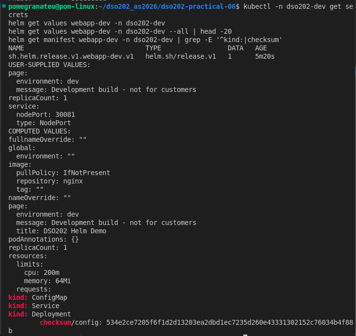

---

## 11. Stage 7: Upgrades and lost values

| Rev | Command | Outcome |
|---|---|---|
| (none) | `helm upgrade ... --set replicaCount=2` | **Failed** (`page.environment must be set`). No revision created |
| 2 | `--set replicaCount=2 --set page.environment=dev` | Succeeded, but the Service became `ClusterIP` and the custom message and NodePort were lost |
| 3 | `-f environments/dev.yaml` | Repaired. NodePort 30081 and the message returned |
| 4 | `--reuse-values --set replicaCount=2` | Kept all `dev.yaml` values and changed only replicas (2/2) |

`--set` without `-f` does not add to the previous values; it replaces them with the chart defaults plus what is on the command line. The `required` guard turned the first such mistake into a loud failure. The second attempt is the silent version: nothing errors and the release quietly changes shape (the Service kept its ClusterIP address, so Helm updated it in place). `--reuse-values` is safer for one-off changes, but it also reuses the last release's computed defaults, so a new chart default would not be picked up; `--reset-then-reuse-values` exists for that case.

> **Figure 25.** The failed upgrade (and `helm list` still at revision 1).
> 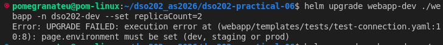
>
> **Figure 26.** Revision 2: history, values and the ClusterIP Service.
> 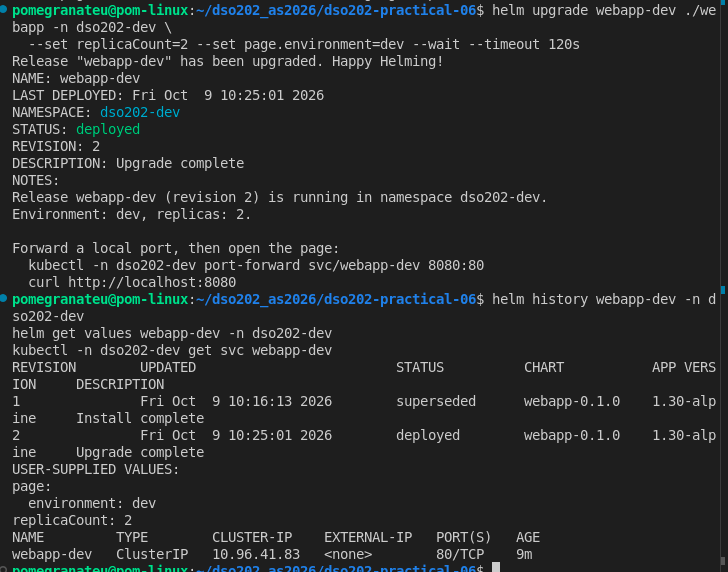
>
> **Figure 27.** Revision 3: values restored and NodePort Service.
> 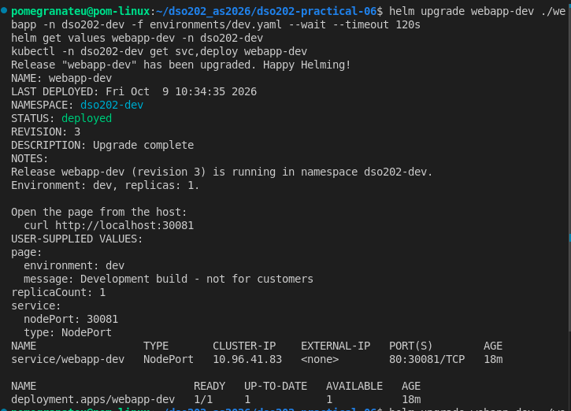
>
> **Figure 28.** Revision 4: `--reuse-values` and the full history.
> 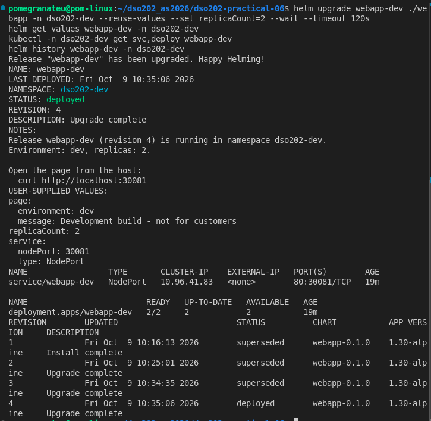

---

## 12. Stage 8: History and rollback

`helm get values --revision 2` showed the two-value set and `--revision 1` the full `dev.yaml` set; Helm keeps all of them in the release Secrets.

```bash
helm rollback webapp-dev 1 -n dso202-dev --wait --timeout 120s
```

The rollback created **revision 5**, described as `Rollback to 1`. History moves forward and does not rewind. The values returned to the `dev.yaml` set, the Service to `NodePort 30081` and the Deployment to `1/1`. Five release Secrets (`v1` to `v5`) existed afterwards. A rollback restores the manifest recorded for the revision, so it compares the current revision to the target, not the live cluster to the target.

> **Figure 29.** Values of revisions 2 and 1.
> 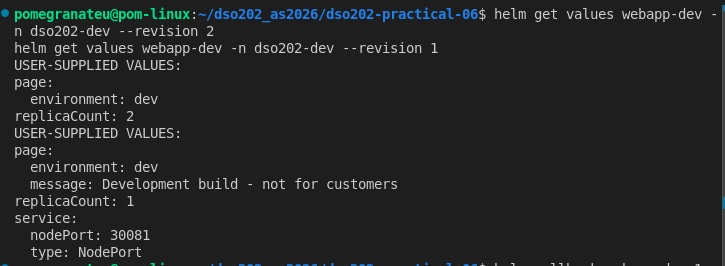
>
> **Figure 30.** Rollback, history with revision 5 and the five Secrets.
> 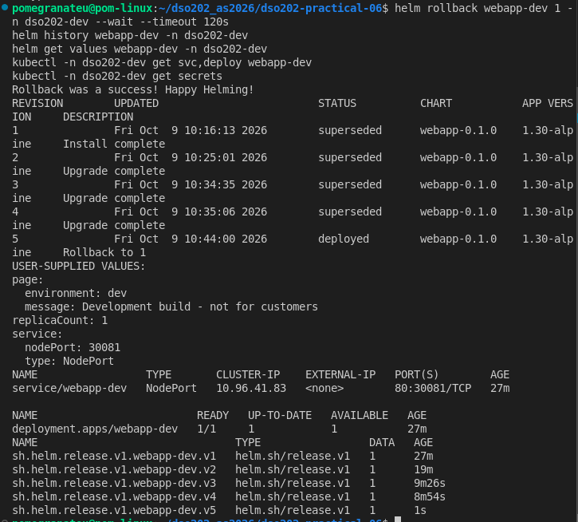

---

## 13. Stage 9: Drift and server-side apply

Helm records what it applied, not the live state. After `kubectl scale deploy webapp-dev --replicas=4`:

- The Deployment showed `1/4` and then `4/4`.
- `helm get values` still said `replicaCount: 1`, the manifest still said `replicas: 1`, and `helm status` still said `deployed`. Helm had no idea the cluster had drifted.
- `--show-managed-fields` listed `helm` (Apply) and `kubectl` (Update, through the `scale` subresource) as owners of `spec.replicas`, plus `kube-controller-manager` for status.

An upgrade with the same values then **failed**:

```
Apply failed with 1 conflict: conflict with "kubectl" with subresource "scale" using apps/v1: .spec.replicas
```

I had expected Helm 4 to overwrite the field. Instead it refused to override another manager's change. The failed attempt also consumed a revision: **revision 6 is recorded as `failed`**, and the live Deployment stayed at 4.

| Resolution | Result |
|---|---|
| `helm upgrade ... --force-conflicts` | Revision 7. Helm took ownership back, replicas returned to 1, and `kubectl` no longer appeared as an owner of `spec.replicas` |
| Scale to 3, then back to 1 with kubectl, then a plain `helm upgrade` | Revision 8 succeeded **without** `--force-conflicts`, because the live value matched what Helm wanted |

A conflict happens when the values differ, not merely because another manager touched the field.

> **Figure 31.** Scale to 4, with Helm still reporting `replicas: 1` and `deployed`.
> 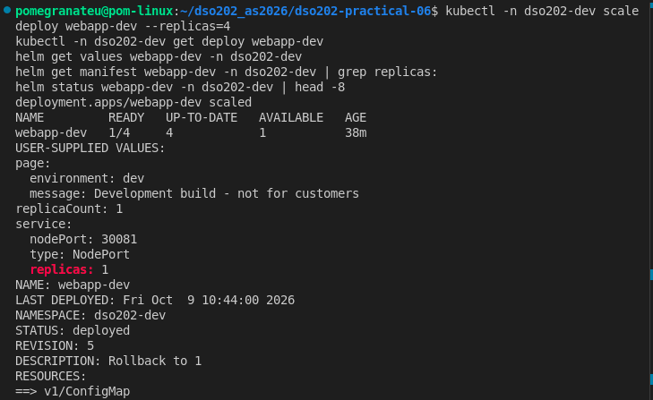
>
> **Figure 32.** Managed fields showing `helm`, `kubectl` and `kube-controller-manager`.
> 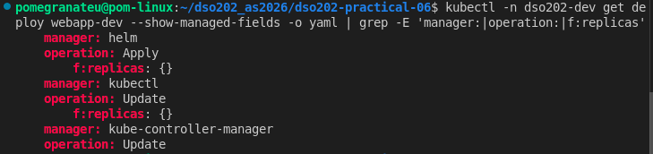
>
> **Figure 33.** The conflict error and the `failed` revision 6.
> 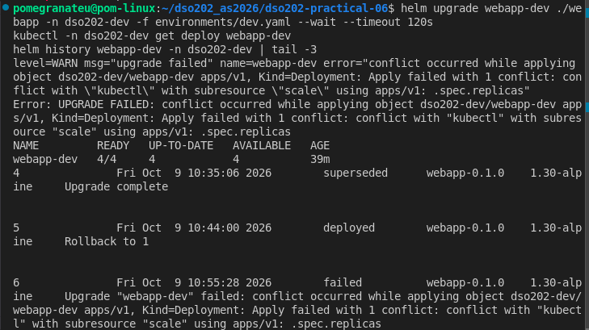
>
> **Figure 34.** `--force-conflicts` upgrade, `1/1` Deployment and managed fields.
> 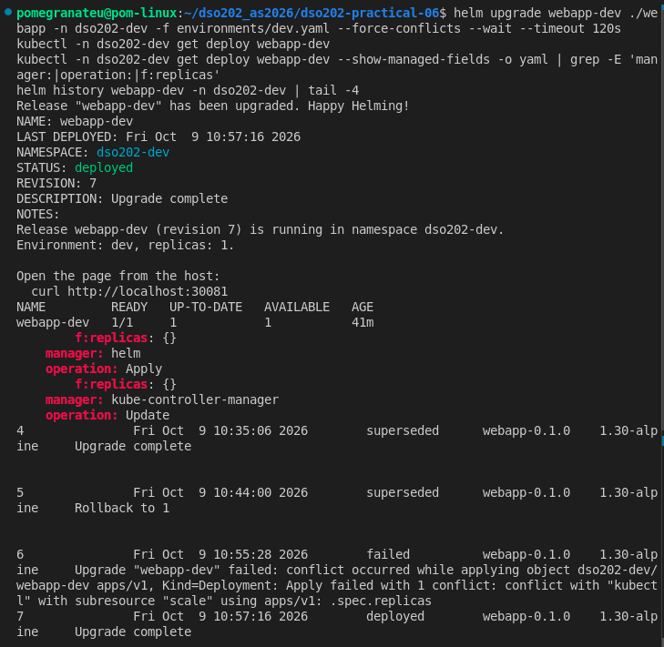
>
> **Figure 35.** The plain upgrade succeeding when the values agree (revision 8).
> 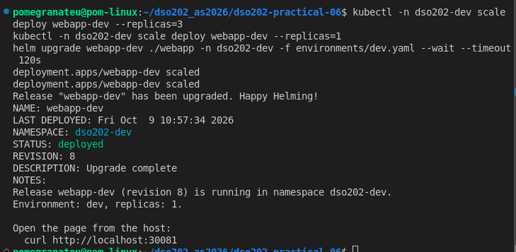

---

## 14. Stage 10: Production release

```bash
helm install webapp-prod ./webapp -f environments/prod.yaml \
  --namespace dso202-prod --create-namespace --wait --timeout 180s
```

| | `webapp-dev` | `webapp-prod` |
|---|---|---|
| Namespace | `dso202-dev` | `dso202-prod` |
| Revision | 8 | 1 |
| Replicas | 1 | 3 |
| Service | NodePort 30081 | ClusterIP |
| Resources | chart defaults (limits 200m / 64Mi) | requests 100m / 64Mi, limits 500m / 128Mi |
| Page message | Development build - not for customers | Production |

Three Pods ran `1/1`, the page (through a port-forward on 8091) showed `Environment: prod`, and `helm test webapp-prod -n dso202-prod` returned `Phase: Succeeded`. The test greps for `Environment: prod`, so it checks the prod release specifically. The same chart produced two different releases using two values files and two namespaces.

> **Figure 36.** Prod install with `helm list -A` showing both releases.
> 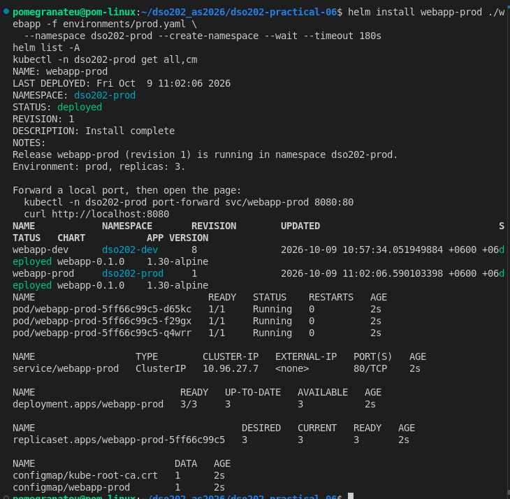
>
> **Figure 37.** Prod objects, page, resources and `helm test`.
> 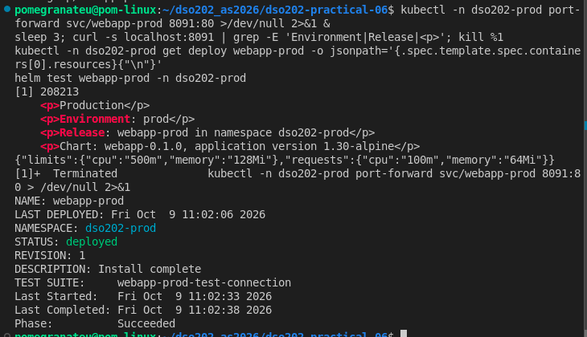

---

## 15. Deviations and lessons

| Where | Expected | What happened | Takeaway |
|---|---|---|---|
| `helm lint` with a missing `required` value | Lint error | Warning only, `0 charts failed` | Do not rely on lint alone; use `helm template` or a server dry run |
| `helm template --namespace` | Objects placed in that namespace | Namespace not applied | The namespace comes from `helm install -n`, not the templates |
| `curl localhost:30081` | Page served | No response | kind maps only host port 30080; use a port-forward |
| Upgrade after `kubectl scale` | Helm overwrites the field | Conflict error, failed revision 6 | Helm 4 server-side apply respects other field managers; use `--force-conflicts` deliberately |
| Dev NodePort | 30080 | Clashed with ingress-nginx from Assignment 2 | Moved to 30081 |

### Troubleshooting notes

- Do not press Ctrl+C during `helm install --wait`: an interrupted install leaves a failed release (`context canceled`) that has to be uninstalled before the name can be reused. This is what happened to the stale `my-podinfo` release.
- Docker Hub image pulls stalled intermittently, so images were pulled on the host and loaded with `kind load docker-image`.
- A failed upgrade still takes a revision number, and a rollback creates a new one, so revision numbers only increase.

## 16. Conclusions

- Helm keeps state in the cluster (one Secret per revision), and anything passed with `--set` is readable there.
- The same `helm upgrade` can silently discard configuration. Keeping every value in files and passing them with `-f` each time avoids it.
- Validation is layered: `required` stops missing values, `values.schema.json` stops wrong types and ranges, and only a server dry run catches cluster-specific conflicts.
- A rollback is a new revision, and a failed upgrade also consumes a revision number.
- Helm 4 server-side apply reports manual drift as an explicit conflict instead of ignoring it.
- One chart plus one values file per environment gives repeatable dev and prod releases.

## 17. Cleanup (optional, after marking)

```bash
helm uninstall webapp-dev -n dso202-dev
helm uninstall webapp-prod -n dso202-prod
kubectl delete namespace dso202-dev dso202-prod
```

The release Secrets are removed with the releases. Keep both releases running until the screenshots are final.

---

## 18. Evidence index

| Fig. | Section | Content |
|---|---|---|
| 1 | 4 | `helm version`, `kubectl get nodes`, empty `helm list -A` |
| 2 | 5.1 | `helm search repo` and `helm show chart` (optional) |
| 3 | 5.1 | `podinfo` install, both `helm list` calls, `get deploy,svc,pods` |
| 4 | 5.2 | `curl` result and `helm get values` (both forms) |
| 5 | 5.2 | `get secrets --show-labels` |
| 6 | 5.2 | Decoded release record (`apply_method: ssa`) |
| 7 | 5.3 | Values-loss upgrade: revision 2, only `ui.color`, one replica |
| 8 | 5.3 | `--reuse-values` upgrade: revision 3, two replicas |
| 9 | 5.3 | Rollback, `helm history` 1 to 4, `--revision` outputs |
| 10 | 5.4 | Uninstall, `No resources found`, namespace still `Active` |
| 11 | 5.4 | OCI install with the `oci://` reference |
| 12 | 7 | `helm template` render and the ConfigMap render |
| 13 | 8 | File layering in both orders |
| 14 | 8 | `--set` versus `--set-string` |
| 15 | 9.1 | `required` error and the lint pair with `level=WARN` |
| 16 | 9.2 | `replicas: lots` and the three schema rejections |
| 17 | 9.2 | `helm lint` failing on the schema |
| 18 | 9.3 | Server dry run failing, client dry run passing |
| 19 | 9.4 | Clean lint for dev and prod, prod server dry run |
| 20 | 10 | `webapp-dev` install with NOTES |
| 21 | 10 | `helm list` and `get all,cm` |
| 22 | 10 | Page through the port-forward (`Environment: dev`) |
| 23 | 10 | `helm test` result |
| 24 | 10 | Release Secret and `helm get values` |
| 25 | 11 | Failed upgrade (`required`) |
| 26 | 11 | Revision 2: history, values, `ClusterIP` Service |
| 27 | 11 | Revision 3 repair with `-f` |
| 28 | 11 | Revision 4 `--reuse-values` and history |
| 29 | 12 | `get values --revision 2` and `--revision 1` |
| 30 | 12 | Rollback, history (revision 5) and the five Secrets |
| 31 | 13 | Scale to 4 while Helm still reports `replicas: 1` |
| 32 | 13 | Managed fields |
| 33 | 13 | Conflict error and `failed` revision 6 |
| 34 | 13 | `--force-conflicts` upgrade and managed fields |
| 35 | 13 | Plain upgrade succeeding when the values agree |
| 36 | 14 | `webapp-prod` install and `helm list -A` |
| 37 | 14 | Prod objects, page, resources and `helm test` |